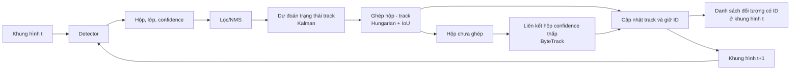

# CHƯƠNG II. CƠ SỞ LÝ THUYẾT VÀ CÔNG TRÌNH LIÊN QUAN

## 2.1. Kiến thức nền tảng

### 2.1.1. Phát hiện vật thể một giai đoạn

Phát hiện vật thể một giai đoạn (one-stage object detection) dự đoán vị trí và lớp của các vật thể trực tiếp từ ảnh trong một lần truyền qua mạng. Khác với phương pháp hai giai đoạn, vốn trước tiên sinh vùng đề xuất rồi mới phân lớp và tinh chỉnh hộp, bộ phát hiện một giai đoạn hợp nhất các bước này để giảm độ trễ và thuận lợi cho xử lý video. Đổi lại, bài toán đòi hỏi mô hình phân biệt vật thể nhỏ với nền ngay trên các bản đồ đặc trưng có độ phân giải khác nhau. Đây là lý do các bộ phát hiện kiểu YOLO thường được dùng làm detector trong hệ thống thời gian thực [1], [12].

Một mô hình YOLO thường được mô tả bằng ba khối. **Backbone** trích xuất đặc trưng không gian từ ảnh; **neck** hợp nhất đặc trưng ở nhiều mức phân giải để giữ cả ngữ cảnh lẫn chi tiết vật thể; **head** dự đoán tọa độ hộp và điểm số lớp trên các mức đặc trưng. Với vật thể UAV nhỏ hoặc ở xa, việc kết hợp các mức đặc trưng là quan trọng vì dấu hiệu nhận dạng có thể chỉ chiếm một vùng rất nhỏ trong ảnh. Ở các phiên bản hiện đại như YOLOv8, head dùng cách dự đoán *anchor-free*: mô hình không cần duy trì trước tập hộp neo có kích thước và tỷ lệ khung hình định sẵn. Cách thiết kế này giảm phụ thuộc vào việc chọn anchor phù hợp với từng bộ dữ liệu; tuy nhiên, chất lượng vẫn phụ thuộc vào độ phân giải đầu vào, đặc trưng đa tỷ lệ và chất lượng nhãn [12].

Detector thường tạo nhiều hộp chồng lấn cho cùng một vật thể. Non-maximum suppression (NMS) sắp xếp hộp theo độ tin cậy, giữ hộp điểm cao nhất rồi loại các hộp cùng lớp có IoU vượt ngưỡng với hộp đã giữ. IoU (intersection over union) giữa hộp dự đoán \(B_p\) và hộp chuẩn \(B_g\) được tính như sau:

$$
\operatorname{IoU}(B_p,B_g)=\frac{|B_p\cap B_g|}{|B_p\cup B_g|}.
$$

NMS giúp giảm dự đoán trùng trước khi chuyển hộp cho tracker, nhưng kết quả nhạy với ngưỡng confidence và IoU; nếu ngưỡng quá chặt, các vật thể gần nhau có thể bị gộp nhầm, còn ngưỡng quá lỏng có thể để lại nhiều hộp trùng [1].

Một hướng khác là DETR, biểu diễn phát hiện như dự đoán một tập đối tượng bằng Transformer và ghép cặp dự đoán–nhãn theo cách tối ưu trong quá trình huấn luyện. Vì đầu ra được tối ưu như một tập, DETR không cần NMS theo cách truyền thống. RT-DETR cải tiến thiết kế để phù hợp hơn với yêu cầu thời gian thực. Bài báo RT-DETR [6] so sánh trực tiếp các detector dựa trên Transformer với YOLO. Trong phạm vi đồ án, RT-DETR là phương án đối chiếu về kiến trúc; không suy ra trước kết quả hay ưu thế thực nghiệm của phương án nào.

### 2.1.2. Theo dõi đa đối tượng theo hướng tracking-by-detection

Tracking-by-detection tách bài toán thành phát hiện vật thể ở từng khung hình và liên kết các phát hiện giữa những khung hình liên tiếp. Mỗi đối tượng đang theo dõi được biểu diễn bằng trạng thái gồm hộp, ID, lớp, thời điểm cập nhật gần nhất và (tùy tracker) điểm tin cậy hoặc đặc trưng ngoại hình. Cách tách này cho phép thay detector mà vẫn giữ quy trình liên kết; chất lượng theo dõi do đó phụ thuộc cả vào detector lẫn quyết định ghép nối.

Trong SORT, bộ lọc Kalman dự đoán vị trí hộp ở khung hình kế tiếp từ trạng thái và vận tốc ước lượng; thuật toán Hungarian giải bài toán gán một-một giữa các hộp dự đoán và phát hiện mới, thường với chi phí dựa trên IoU [14]–[16]. Ghép được chấp nhận khi thỏa ngưỡng tương đồng; phát hiện chưa ghép có thể khởi tạo track mới, còn track không được cập nhật sẽ được giữ trong một khoảng thời gian rồi loại. Bộ lọc Kalman hữu ích khi chuyển động giữa các khung hình tương đối liên tục, nhưng dự đoán có thể lệch khi vật thể đổi hướng đột ngột hoặc camera rung; ghép dựa riêng trên hình học cũng dễ nhầm khi nhiều mục tiêu ở gần nhau.

ByteTrack khai thác thêm các hộp có confidence thấp thay vì loại bỏ toàn bộ chúng trước bước liên kết. Trước hết, các track được ghép với hộp confidence cao; các track chưa ghép sau đó được đối chiếu với hộp confidence thấp để tận dụng dấu vết yếu nhưng nhất quán theo thời gian. Những hộp thấp chưa ghép không mặc nhiên tạo track mới, nhằm hạn chế khởi tạo từ nhiễu nền [2]. Cách làm này đặc biệt phù hợp để phân tích trường hợp UAV nhỏ hoặc bị che khuất tạm thời khiến confidence suy giảm, nhưng không thể bù cho một detector bỏ sót kéo dài.

BoT-SORT mở rộng liên kết bằng hiệu chỉnh chuyển động camera (camera-motion compensation) trước khi so khớp hộp; đồng thời có thể kết hợp đặc trưng tái nhận dạng (ReID) để hỗ trợ phân biệt các đối tượng có hình học gần nhau [3]. Các thành phần này có thể giảm lỗi liên kết do camera dịch chuyển hoặc do mục tiêu đi sát nhau, nhưng làm tăng yêu cầu tính toán và phụ thuộc vào chất lượng ước lượng chuyển động cũng như đặc trưng ReID. Với camera cố định, lợi ích của bù chuyển động cần được đánh giá thay vì mặc định là cần thiết.

**Hình 2.1.** Quy trình tracking-by-detection do tác giả tự dựng, khái quát từ SORT [14] và bước liên kết hộp confidence thấp của ByteTrack [2]. Hình không mô tả đầy đủ mọi biến thể hay tham số của các thuật toán.
<!-- Ghi chú cho Quang: xuất sơ đồ Mermaid thành PNG khi tích hợp vào bản Word/PDF. -->

### 2.1.3. Các độ đo phát hiện và theo dõi

IoU đo mức chồng lấp giữa hộp dự đoán và hộp chuẩn; một cặp hộp thường được xem là khớp khi IoU đạt ngưỡng quy định. **Precision** là tỷ lệ dự đoán dương tính đúng trên tổng dự đoán dương tính; **recall** là tỷ lệ đối tượng chuẩn được phát hiện. F1 là trung bình điều hòa của hai đại lượng:

$$
P=\frac{TP}{TP+FP},\qquad R=\frac{TP}{TP+FN},\qquad
F1=\frac{2PR}{P+R}.
$$

Trong đó \(TP\), \(FP\), \(FN\) lần lượt là số phát hiện đúng, dương tính giả và âm tính giả theo quy tắc ghép đã chọn. AP (average precision) là diện tích dưới đường precision–recall của một lớp; mAP là trung bình AP trên các lớp. **mAP@0.5** dùng điều kiện IoU từ 0,5 để xác định phát hiện đúng; **mAP@0.5:0.95** lấy trung bình AP tại các ngưỡng IoU từ 0,50 đến 0,95, bước 0,05, theo quy ước COCO [19]. Vì ngưỡng IoU cao đòi hỏi hộp định vị chính xác hơn, hai chỉ số này phản ánh các mức chặt khác nhau; khi so sánh cần nêu rõ ngưỡng, tập đánh giá và cách lấy trung bình.

Đối với theo dõi, **IDF1** đo mức chính xác của danh tính trên các đoạn track sau khi ghép danh tính dự đoán với chuẩn; **ID switch** đếm số lần ID dự đoán của cùng một đối tượng thay đổi trong chuỗi thời gian [18]. **HOTA** cân bằng chất lượng phát hiện và liên kết danh tính, đồng thời đánh giá chúng qua nhiều ngưỡng ghép, nên hữu ích khi một chỉ số đơn lẻ có thể che khuất sự đánh đổi giữa hai phần [17]. Các chỉ số theo dõi cần dùng chuỗi video có nhãn ID; mAP của detector riêng không thể thay thế chúng. Khi báo cáo kết quả, cần nêu bộ dữ liệu, giao thức ghép, ngưỡng và biến thể metric để tránh diễn giải những số đo không cùng điều kiện như thể so sánh trực tiếp được.

## 2.2. Công trình và hệ thống liên quan

Bảng 2.1 so sánh dữ liệu và tracker theo nhiệm vụ, phương pháp, metric, giới hạn và mức độ phù hợp. Các metric nêu dưới đây mô tả giao thức của nguồn, không phải kết quả đồ án. VisDrone và UAVDT dùng camera gắn trên UAV nhìn xuống; đồ án hướng tới quan sát vật thể bay từ camera mặt đất, nên hai benchmark này chỉ tham khảo cho vật thể nhỏ và đánh giá MOT [4], [5], [7], [11].

**Bảng 2.1. So sánh dữ liệu và phương pháp liên quan**

| Công trình/dữ liệu | Nhiệm vụ | Dữ liệu | Phương pháp | Metric được dùng/báo cáo | Hạn chế | Khác biệt so với đồ án |
|---|---|---|---|---|---|---|
| Svanström và cộng sự [11] | Phát hiện UAV đa cảm biến | Video mặt đất, khả kiến/hồng ngoại; UAV, chim, máy bay, trực thăng. | Dataset và nhãn theo khung hình; không phải benchmark MOT chuẩn hóa. | Không có metric MOT chung; detector cần AP với split/IoU nêu rõ. | Miền cảnh, cảm biến, căn chỉnh nhãn và điều kiện cấp phép cần được xét. | Gần hình học quan sát và có lớp âm tính liên quan; đánh giá trên split đồ án riêng. |
| Anti-UAV [13] | Theo dõi UAV đơn mục tiêu | Chuỗi RGB/hồng ngoại có nhãn theo dõi UAV. | Benchmark visual tracking một mục tiêu. | Success và precision theo giao thức tracker. | Không bao quát MOT hoặc phân lớp nhiều loại vật thể bay. | Tham khảo bám UAV/che khuất; không thay thế đánh giá đa lớp, đa mục tiêu. |
| VisDrone-DET [4] | Phát hiện đối tượng | Ảnh UAV nhìn xuống; người, phương tiện và vật thể mặt đất nhỏ. | Benchmark phát hiện VisDrone-DET. | AP theo giao thức thử thách. | Góc nhìn và lớp mục tiêu khác đồ án; cảnh đông đúc, che khuất. | Tham khảo vật thể nhỏ; UAV là camera, không phải vật thể cần phát hiện. |
| VisDrone-MOT [5] | Theo dõi nhiều đối tượng | Video UAV nhìn xuống có ID; trọng tâm là đối tượng mặt đất. | Thử thách MOT với detector và tracker dự thi. | Metric MOT theo giao thức; MOTA/IDF1 trong các báo cáo tương ứng. | Khác hướng camera/lớp mục tiêu; phụ thuộc detector và mật độ che khuất. | Tham khảo đánh giá ID trong cảnh đông, không đại diện UAV trên nền trời. |
| UAVDT [7] | Phát hiện/theo dõi phương tiện | Video đường phố từ UAV; xe ở nhiều góc nhìn và mật độ. | Benchmark detection và tracking có thuộc tính cảnh. | AP cho detection; MOTA/MOTP cho tracking. | Camera trên không và phương tiện mặt đất khác mục tiêu đồ án. | Tham khảo benchmark đa cảnh và phân tích lỗi, không phải dữ liệu UAV mục tiêu. |
| ByteTrack [2] | MOT tracking-by-detection | Benchmark MOT tổng quát; tracker nhận hộp/confidence. | Ghép hộp điểm cao, rồi dùng hộp điểm thấp để khôi phục track. | HOTA, IDF1, MOTA trên benchmark bài báo. | Nhạy với detector/ngưỡng; hộp điểm thấp có thể là nhiễu. | Đối chiếu khả năng giữ ID khi confidence giảm; cần đo lại trên video đồ án. |
| BoT-SORT [3] | MOT tracking-by-detection | Benchmark MOT nhiều người; detection theo khung hình. | Ghép hình học, bù chuyển động camera, ReID tùy chọn. | HOTA, IDF1, MOTA trên benchmark bài báo. | ReID tốn thêm tính toán; bù camera có thể ít cần trên camera cố định. | Đối chứng ByteTrack khi camera rung/mục tiêu gần nhau; lợi ích cần được kiểm tra. |

Nhìn chung, benchmark MOT giúp tham khảo cách đo nhưng không thay thế đánh giá đúng hình học camera và lớp mục tiêu của đồ án. Svanström gần bài toán hơn; Anti-UAV bổ sung tham khảo đơn mục tiêu; VisDrone/UAVDT chủ yếu hỗ trợ nghiên cứu vật thể nhỏ từ góc nhìn UAV. ByteTrack và BoT-SORT cần được so sánh trên cùng detector, chuỗi video và giao thức ghép.

### Tài liệu tham khảo bổ sung cho bản nháp

Các mục [1]–[12] được giữ theo danh mục của bản v0.3. Các nguồn mới dưới đây tiếp tục số thứ tự để hỗ trợ phần 2.1–2.2:

[13] N. Jiang, K. Wang, X. Peng, X. Yu, Q. Wang, J. Xing, G. Li, G. Guo, Q. Ye, J. Jiao, J. Zhao, and Z. Han, “Anti-UAV: A Large-Scale Benchmark for Vision-Based UAV Tracking,” *IEEE Transactions on Multimedia*, vol. 25, pp. 486–500, 2023. https://doi.org/10.1109/TMM.2021.3128047. Preprint: https://arxiv.org/abs/2101.08466

[14] A. Bewley, Z. Ge, L. Ott, F. Ramos, and B. Upcroft, “Simple Online and Realtime Tracking,” in *Proceedings of the IEEE International Conference on Image Processing (ICIP)*, pp. 3464–3468, 2016. https://arxiv.org/abs/1602.00763

[15] R. E. Kalman, “A New Approach to Linear Filtering and Prediction Problems,” *Journal of Basic Engineering*, vol. 82, no. 1, pp. 35–45, 1960. https://doi.org/10.1115/1.3662552

[16] H. W. Kuhn, “The Hungarian Method for the Assignment Problem,” *Naval Research Logistics Quarterly*, vol. 2, nos. 1–2, pp. 83–97, 1955. https://doi.org/10.1002/nav.3800020109

[17] J. Luiten, A. Osep, P. Dendorfer, P. Torr, A. Geiger, and L. Leal-Taixé, “HOTA: A Higher Order Metric for Evaluating Multi-Object Tracking,” *International Journal of Computer Vision*, vol. 129, pp. 548–578, 2021. https://doi.org/10.1007/s11263-020-01375-2

[18] E. Ristani, F. Solera, R. Zou, R. Cucchiara, and C. Tomasi, “Performance Measures and a Data Set for Multi-Target, Multi-Camera Tracking,” in *Proceedings of the European Conference on Computer Vision Workshops (ECCVW)*, 2016. https://arxiv.org/abs/1609.01775

[19] T.-Y. Lin, M. Maire, S. Belongie, J. Hays, P. Perona, D. Ramanan, P. Dollár, and C. L. Zitnick, “Microsoft COCO: Common Objects in Context,” in *Computer Vision – ECCV 2014*, pp. 740–755, 2014. https://arxiv.org/abs/1405.0312
