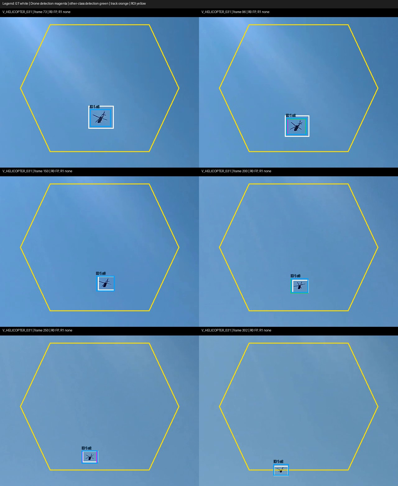
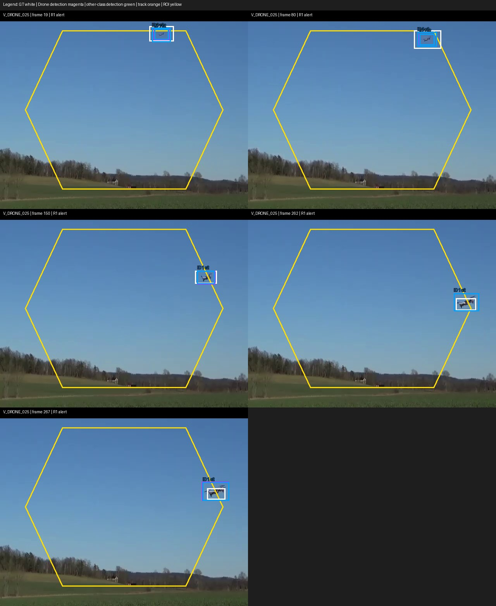
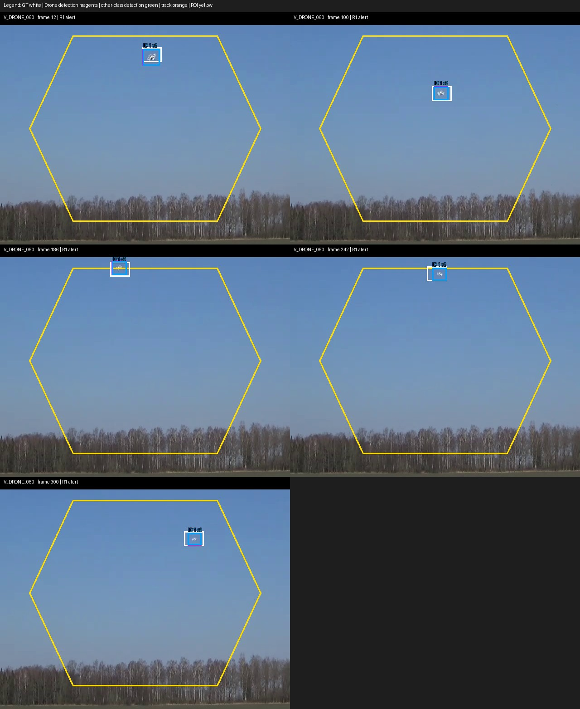
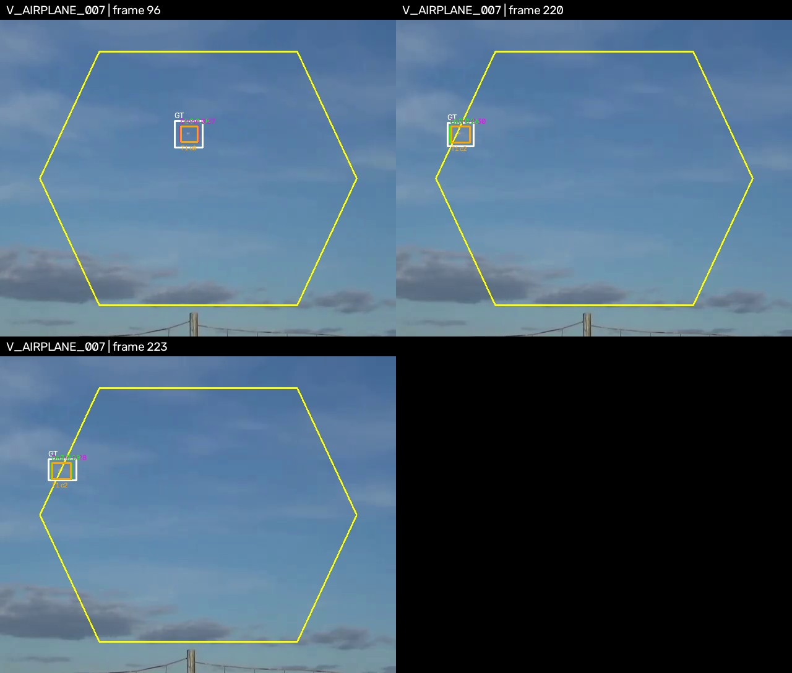
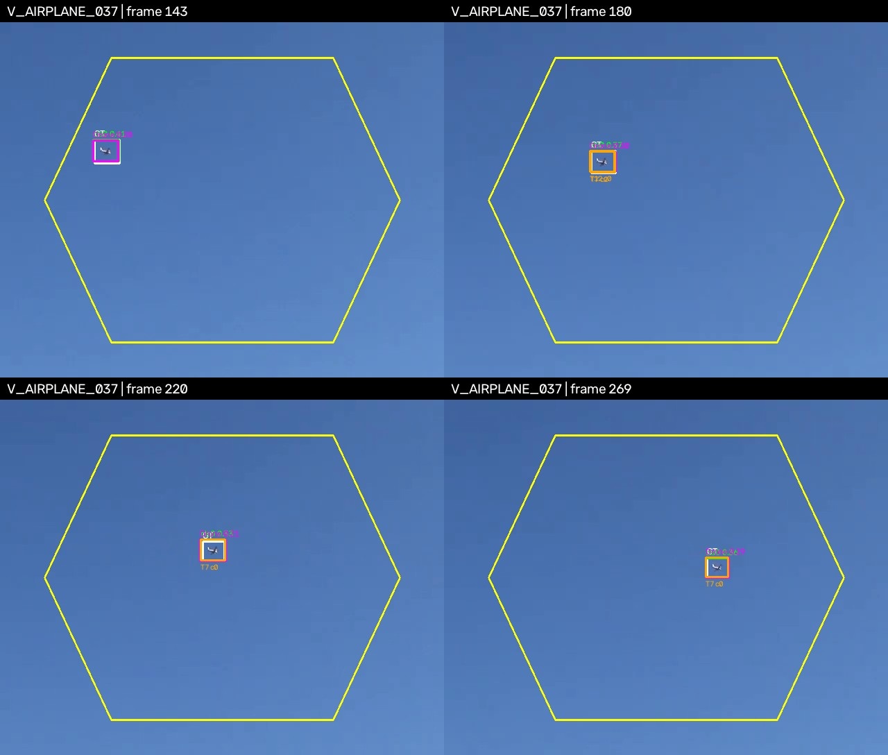
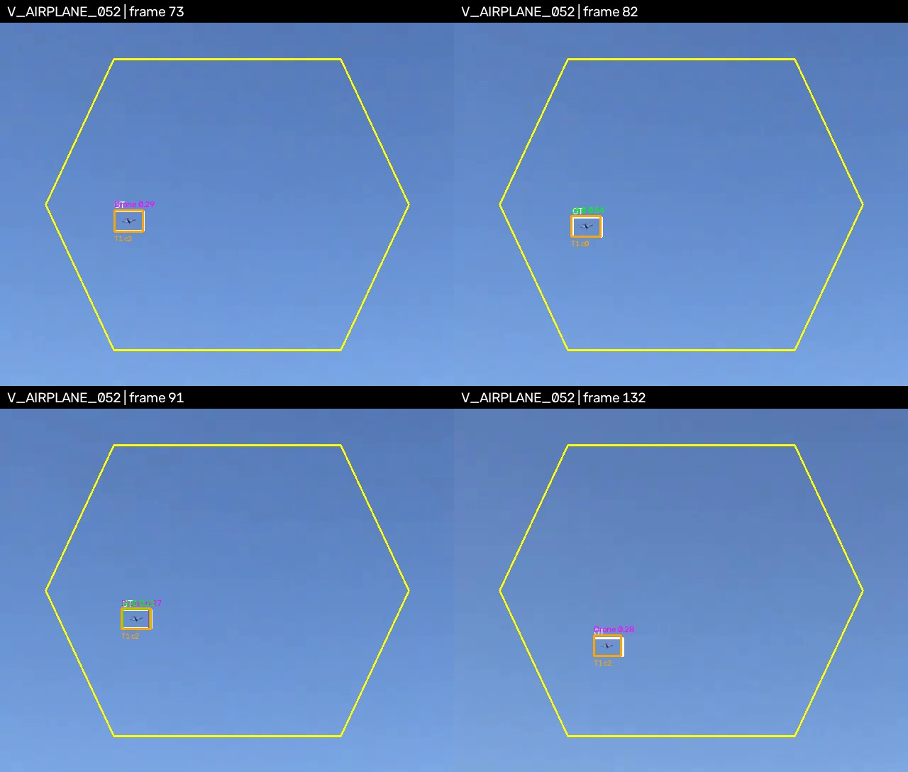
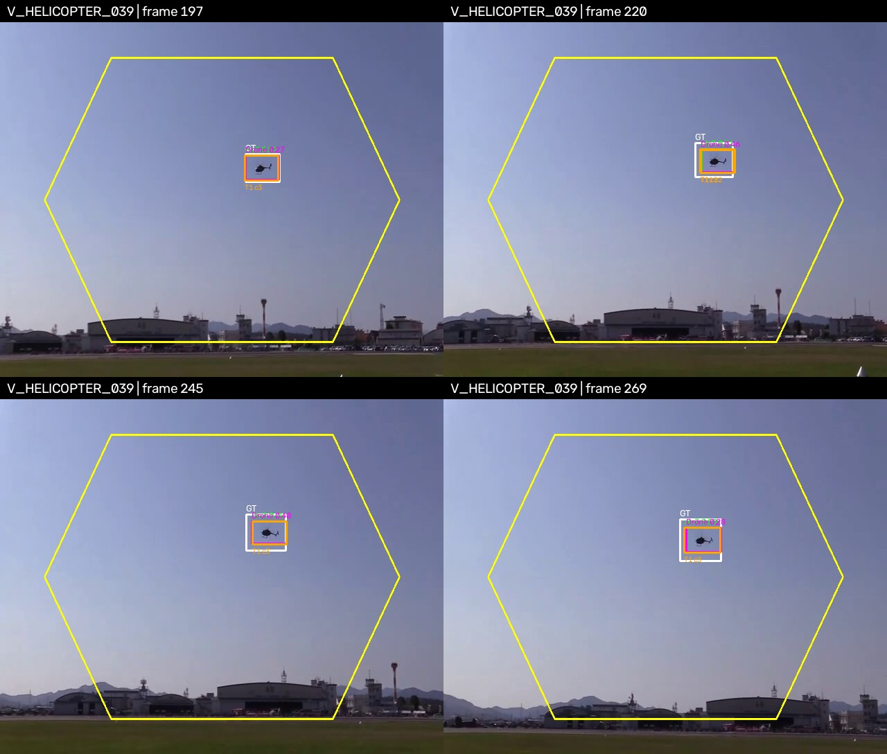
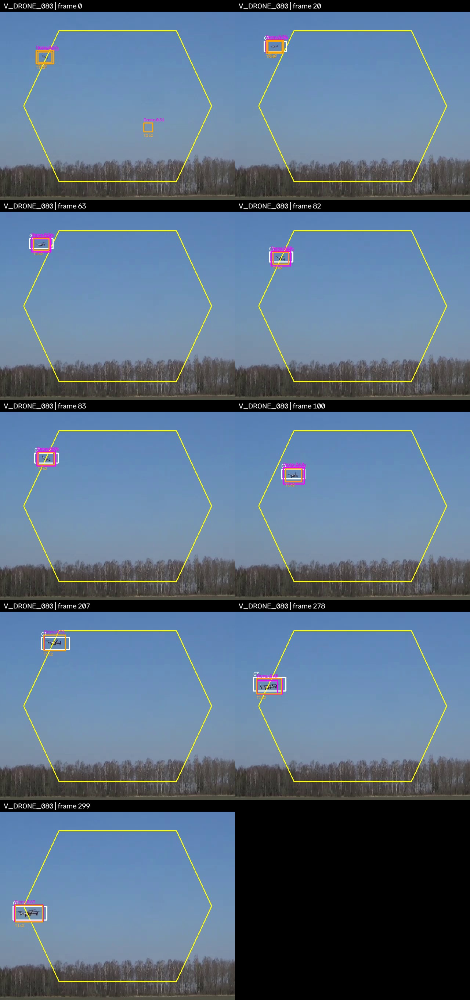

# W6-05 — Phân tích lỗi cảnh báo run 14 (#78)

## Phạm vi và cách đối chiếu

Đánh giá trên validation, ROI chính `center_hex`, điểm đại diện `center`, theo cấu hình đã khóa trong ADR-0009. Nguồn số liệu là `results/W06/alert_eval/alert_log.csv`, `per_video_alerts.csv`, `gt_events.csv`, các detection/track/GT của run 14 và `results/W06/duplicate_boxes.json`.

Quang cung cấp hai archive video gốc kèm nhãn MATLAB MCOS `*_LABELS.mat`. `V_VIDS_3.zip` có SHA-256 `e227e65b1d7c9119405964b6c06ea00279350aec72bf0bedf0e4f74dd0c61288`; `V_VIDS_4.zip` có SHA-256 `25cf4284d8714357af6aee5c81e5ac498d4397e0086d5b9efdc1ee237e7fee86`. Dùng `mcos_decoder` để giải mã nhãn; đối chiếu với GT CSV của run 14 cho thấy các hộp nhãn trong frame video khớp chính xác. `V_DRONE_080` có 300 frame video, 301 slot nhãn, trong đó frame 0 rỗng và slot cuối nằm ngoài video; chỉ so sánh 300 frame thật.

Các hình dưới đây lấy mẫu frame có ghi số frame, vẽ ROI vàng, GT trắng, detection Drone màu tím, detection lớp khác màu xanh lá và track màu cam:

Các clip bổ sung xác minh các alert R0 còn lại:

## Kết quả tổng thể và giới hạn phép đo

Theo `alert_summary.json`, ở ROI/điểm chính:

| Luật | Sự kiện GT | Được phát hiện | Event recall | Tổng cảnh báo | Sai trên video không Drone | Sai trên video Drone | Cảnh báo lặp | Độ trễ trung vị |
|---|---:|---:|---:|---:|---:|---:|---:|---:|
| R0 | 23 | 23 | 1,0 | 31 | 7 | 1 | 0 | −0,033 s |
| R1 | 23 | 23 | 1,0 | 25 | 0 | 0 | 2 | 0,233 s |

- R1 không có cảnh báo sai hoặc sự kiện bỏ sót theo quy tắc ghép đã đăng ký trước (giao khoảng cảnh báo với GT mở rộng ±1 giây). Do đó, không có sự kiện sai/bỏ sót R1 để gán nguyên nhân.
- Tuy nhiên, bộ ghép cho phép nhiều cảnh báo cùng khớp một GT. Hai cảnh báo R1 dư là `V_DRONE_078` frame 141–146 (cùng GT frame 126–299 với cảnh báo frame 204–299) và `V_DRONE_096` frame 285–295 (cùng GT frame 21–296 với cảnh báo frame 48–223). Chúng là cảnh báo lặp, không phải sự kiện GT bị bỏ sót; ID của hai đoạn lần lượt là 6→13 và 6→22. Vì vậy event precision 1,0 theo cách tính hiện tại không đồng nghĩa ghép một-một; số cảnh báo lặp phải được đọc kèm.
- 21 video không Drone chỉ cung cấp 0,0611 giờ (khoảng 3,7 phút). Kết quả hỗ trợ phát biểu hẹp “0 cảnh báo sai R1 quan sát được trên mẫu val này”, không chứng minh tỷ lệ sai vận hành bằng 0. Mốc Poisson xấp xỉ 3/0,0611 ≈ 49 cảnh báo/giờ là giới hạn trên 95% minh họa nếu giả sử sự kiện độc lập, đồng nhất; giả định độc lập theo thời gian/video không được bảo đảm nên đây không phải ước lượng triển khai. Mức 114,6 cảnh báo/giờ của R0 cũng chỉ là ngoại suy từ 7 sự kiện trong mẫu ngắn.
- Dữ liệu một nhãn mục tiêu mỗi video và ROI mô phỏng cũng hạn chế việc phân biệt vật thể thật không được gán nhãn với cảnh báo sai.

## Từng cảnh báo sai R0 trên video không Drone

Các frame trong bảng là khoảng alert ghi trong log; số detection là các detection Drone `conf ≥ 0,25` có tâm trong `center_hex` tại các frame của khoảng đó. “Chồng lớp khác” đếm frame có ít nhất một detection lớp khác chồng IoU ≥ 0,5 với detection Drone trong cùng frame. Overlap là bằng chứng hình học, không tự nó chứng minh hai hộp cùng một vật.

| Video | Frame cảnh báo | Detection Drone trong ROI | Frame có overlap lớp khác | Đánh giá nguyên nhân |
|---|---:|---:|---:|---|
| `V_AIRPLANE_007` | 96–96 | 1 | 1 | Đã xem clip: vật thể được gán nhãn Airplane; Drone detection trùng một phần hộp GT (IoU 0,378), phù hợp với nhầm lớp kèm định vị hộp kém. |
| `V_AIRPLANE_007` | 220–223 | 3 | 3 | Đã xem clip: Drone detections theo cùng máy bay được gán nhãn (IoU GT ≥ 0,5 ở cả 3 frame có detection); frame 221 không có Drone detection nhưng alert được gộp qua gap. |
| `V_AIRPLANE_037` | 143–269 | 44 | 44 | Đã xem clip: máy bay được gán nhãn; cả 44 frame có Drone detection đều chồng GT IoU ≥ 0,5 (IoU GT tốt nhất trung vị 0,858). Đây là nhầm lớp kéo dài. |
| `V_AIRPLANE_052` | 73–91 | 5 | 1 | Đã xem clip: máy bay được gán nhãn; 5 Drone detections đều chồng GT IoU ≥ 0,5. Detector dao động lớp theo frame; overlap giữa các detection không cần thiết để nhận ra đây là nhầm lớp. |
| `V_AIRPLANE_052` | 132–132 | 1 | 0 | Đã xem clip: vật thể được gán nhãn Airplane và Drone detection chồng hộp GT (IoU 0,786). Không có detection Airplane cùng frame, nên đây là nhầm lớp, không phải hộp trùng cross-class. |
| `V_HELICOPTER_031` | 73–302 | 40 | 29 | Đã xem video: cả 40 hộp Drone có IoU ≥ 0,5 với GT trực thăng (IoU trung vị 0,807). Đây là nhầm lớp Drone trên trực thăng; cảnh báo kéo dài do R0 gộp các đoạn theo cửa sổ 1 giây. Track ID 1 mang lớp Helicopter nên R1 không cảnh báo. |
| `V_HELICOPTER_039` | 197–269 | 26 | 26 | Đã xem clip: vật thể là trực thăng; 24/26 frame có Drone detection chồng GT IoU ≥ 0,5, cả 26 frame có detection lớp Helicopter chồng với detection Drone. Đây là nhầm lớp kéo dài. |

Trong bảy cảnh báo sai R0 trên video không Drone, sáu khoảng có ít nhất một overlap lớp khác. Tổng cộng có 120 frame chứa detection Drone trong các khoảng này; 104 frame có overlap IoU ≥ 0,5. Riêng `V_HELICOPTER_031`, bằng chứng GT và video xác nhận trực tiếp lỗi lớp. Không quy 15 detection Drone không overlap còn lại cho cùng một nguyên nhân nếu chưa xem video tương ứng.

R0 còn một cảnh báo không khớp trên video Drone `V_DRONE_080`, frame 0. Clip cho thấy một UAV thật ở ngoài ROI, cùng vị trí với hộp GT bắt đầu từ frame 1; riêng hộp Drone conf 0,511 tạo alert trong ROI nằm trên vùng trời trống và không trùng GT. Bằng chứng trực quan ủng hộ một false positive rời rạc, không phải UAV thật bị bỏ sót trong GT. Dung sai ghép ±30 frame không khớp alert này với hai sự kiện Drone về sau.

## Video demo R1

| Video | GT trong `center_hex` | Cảnh báo R1 | Đối chiếu hình ảnh |
|---|---|---|---|
| `V_DRONE_060` | 5–187 và 234–307 | 12–186 và 242–307 | Hai cảnh báo theo đúng hai sự kiện; trễ lần lượt 7 frame (0,233 s) và 8 frame (0,267 s), phù hợp với xác nhận và dwell đã chốt. Không thấy cảnh báo sai/bỏ sót trong clip. |
| `V_DRONE_025` | 12–169 và 255–269 | 19–167 và 262–267 | Hai cảnh báo khớp hai sự kiện, mỗi cảnh báo bắt đầu trễ 7 frame (0,233 s). Cảnh báo thứ hai ngắn (6 frame) và dừng trước cuối GT 2 frame; vẫn khớp theo tiêu chí ±1 giây. Không thấy cảnh báo sai/bỏ sót trong clip; việc chọn video vì nhiều ID switch không chứng minh mọi switch đã được xử lý. |
| `V_HELICOPTER_031` | Không có sự kiện Drone | R1 không cảnh báo | GT và video là trực thăng xuyên suốt cảnh báo sai R0; detection Drone chồng lên hộp GT trong 40 frame. R1 loại trường hợp này nhờ track lớp Helicopter. |

## Đề xuất W7 (chưa thay ngưỡng)

1. Thu thêm video âm tính/hard negative độc lập đến ít nhất 2 giờ; báo số sự kiện theo video và độ bất định ở cấp video. Không dùng 3,7 phút val để tuyên bố tỷ lệ cảnh báo sai triển khai.
2. Đã xem video gốc và đối chiếu GT cho các alert R0 trong `V_VIDS_3.zip`/`V_VIDS_4.zip`; không dùng kết quả này để đổi ngưỡng đã khóa. Phân tích riêng 38/40 ảnh val âm tính có FP vẫn cần ảnh gốc (hiện report chỉ có số đếm, không có ảnh hay danh sách đường dẫn ảnh).
3. Thử riêng biệt NMS không phân lớp và giảm NMS IoU như ghi ở PR #87, trên protocol mới có đối chứng. Tách chỉ số detection/classification khỏi theo dõi và cảnh báo; giữ nguyên ngưỡng ADR-0009 trong báo cáo W6.
4. Báo cả event recall, tổng cảnh báo, cảnh báo lặp và ghép sự kiện một-một (hoặc nêu rõ chính sách nhiều-cảnh-báo/một-sự-kiện), cùng độ trễ. Không suy diễn độ chính xác theo sự kiện chỉ từ `event_precision=1,0` hiện tại.

## Nguồn

- `results/W06/alert_eval/alert_log.csv`, `per_video_alerts.csv`, `gt_events.csv`, `alert_summary.json`, `README.md`.
- `results/W06/kaggle_run_14/w6_run14/dets/`, `tracks/tracker_bytetrack_e1/`, `gt/`, `inputs.json`.
- `results/W06/duplicate_boxes.json`; `scripts/reporting/duplicate_box_stats.py`.
- Video/nhãn người dùng cung cấp trong `V_VIDS_3.zip` và `V_VIDS_4.zip` (SHA-256 ở trên); ảnh đối chiếu mẫu trong `docs/w6/figures/`.
- ADR-0009 mục 6–7; giới hạn dữ liệu val và ngưỡng giữ nguyên theo protocol.
