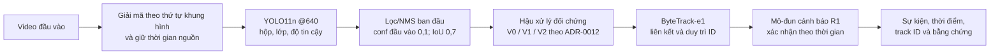

# CHƯƠNG III. PHƯƠNG PHÁP VÀ THIẾT KẾ THỰC NGHIỆM

## 3.3. Phương pháp đề xuất

Phương pháp được tổ chức thành một pipeline xử lý video thống nhất, từ giải mã khung hình đến phát sinh sự kiện cảnh báo. Detector được chọn là YOLO11n theo ADR-0007; các hộp phát hiện được đưa qua ByteTrack-e1, sau đó mô-đun cảnh báo R1 xác định đối tượng Drone đi vào vùng quan tâm. Cách kết hợp detector với tracker dựa trên tracking-by-detection: detector cung cấp hộp, lớp và độ tin cậy ở từng khung hình, còn tracker liên kết các hộp theo thời gian để duy trì ID [1], [2].

**Hình 3.1.** Pipeline xử lý và đánh giá được đề xuất; V1 và V2 là các biến thể hậu xử lý trong ADR-0012, không phải kết quả đã được xác nhận.

Ở bước đầu, video được giải mã tuần tự để bảo toàn thứ tự khung hình và thời gian nguồn. Mỗi khung hình được đưa vào YOLO11n ở cấu hình kích thước đầu vào 640. Theo cấu hình run 14, detector chuyển các hộp có độ tin cậy từ 0,1 cho bước liên kết; NMS theo lớp ở IoU 0,7 là xử lý ban đầu của detector. Ngưỡng này không đồng nhất với ngưỡng 0,25 dùng để xác định bằng chứng Drone cho các luật cảnh báo R0 và R1 [1], ADR-0007, ADR-0009.

Để so sánh hậu xử lý chống hộp trùng, ADR-0012 định nghĩa V0 là đầu ra hiện tại, V1 là NMS không phân lớp ở IoU 0,5 và V2 là NMS cùng lớp ở IoU 0,5. Mỗi biến thể chỉ thay một yếu tố so với V0; các hộp sau bước này được phát lại offline qua cùng ByteTrack-e1 và luật cảnh báo. Do ADR-0012 đang ở trạng thái Proposed, V1 và V2 chỉ được chạy sau khi ADR được chấp nhận. Đây là thử nghiệm hậu xử lý trên detection đã lưu, không tương đương việc thay NMS bên trong detector trước khi suy luận.

ByteTrack-e1 ghép các hộp với track đang có và khai thác hộp điểm thấp trong liên kết nhằm duy trì ID khi độ tin cậy dao động [2]. Mô-đun R1 chỉ dùng bằng chứng detection thực tế, không phát cảnh báo từ vị trí tracker dự đoán. Một track cần có ít nhất ba bằng chứng Drone trong năm khung hình gần nhất; lớp đa số của track cũng phải là Drone. Sau khi xác nhận, tâm hộp phải nằm liên tục trong ROI `center_hex` ít nhất 0,3 giây, tương đương chín khung hình ở 30 fps. Track hết bằng chứng trong ROI quá một giây thì cảnh báo kết thúc. Quy tắc gộp sự kiện và nối các track trùng hoặc đổi ID giữ nguyên theo ADR-0009.

Xác nhận nhiều khung hình nhằm loại các dự đoán Drone nhất thời, chẳng hạn một hộp sai lớp trên máy bay hoặc trực thăng, trước khi chúng trở thành sự kiện. So sánh hệ thống vì vậy có hai mốc khác nhau cần phân biệt. Ở mức chọn detector, YOLO11n được so với YOLOv8n baseline A theo giao thức ba seed của ADR-0007; mức chênh mAP@0.5:0.95 là 0,0061, nằm trong vùng hòa 0,01, còn F1 Drone trung bình cao hơn 0,0142 và là tiêu chí phụ đã định trước để chọn YOLO11n. Ở mức cảnh báo, R0 là luật detector-only, còn R1 là phương pháp đề xuất có liên kết track và xác nhận theo thời gian. Trên validation W6, R0 có bảy cảnh báo sai trên video không có Drone trong khi R1 không có cảnh báo sai quan sát được; cả hai đạt event recall 1,0 trên 23 sự kiện. Kết quả này chỉ mô tả khoảng 3,7 phút video không có Drone, vì vậy không chứng minh tỷ lệ cảnh báo sai bằng không trong điều kiện vận hành [11], ADR-0009.

## 3.4. Thiết kế thí nghiệm và tiêu chí đánh giá

Thí nghiệm bám theo ba câu hỏi nghiên cứu ở mục 1.2; trong thuyết minh hiện hành, các câu hỏi này nằm tại mục 6.2. Q1 xem xét liệu tăng độ phân giải đầu vào hoặc xử lý theo ô ảnh có cải thiện recall của vật thể nhỏ đủ để bù chi phí tính toán hay không. Q2 xem xét mức giảm cảnh báo sai nhờ xác nhận theo thời gian và tracking, cùng phần độ trễ tăng thêm. Q3 xem xét mức suy giảm khi thay đổi nguồn camera, nền cảnh và mức nén video. Trong phạm vi W7, so sánh R0–R1 và phép thử hậu xử lý theo ADR-0012 chủ yếu cung cấp bằng chứng cho Q2; chưa kết luận cho Q1 hay Q3.

### Dữ liệu và nguyên tắc so sánh

Đơn vị chia dữ liệu là video, không chia ngẫu nhiên các khung hình của cùng video sang nhiều tập. Tập train được dùng cho huấn luyện; validation được dùng để chọn checkpoint, ngưỡng và so sánh các biến thể. Tập test vẫn khóa đến W10 theo kế hoạch dự án, không dùng để lựa chọn mô hình, ngưỡng hoặc hậu xử lý. Split theo video hạn chế rò rỉ giữa các khung hình liền kề, nhưng chưa bảo đảm test hoàn toàn khác cảnh vì dữ liệu có thể lặp nền [11], ADR-0003.

So sánh mỗi lần chỉ thay một yếu tố, giữ cố định dữ liệu, detector, tracker, luật cảnh báo và cấu hình chạy còn lại. Với so sánh mô hình đã đăng ký, sử dụng ba seed chung theo ADR-0007 và báo cáo trung bình, độ lệch chuẩn cùng khoảng min–max; chênh lệch mAP@0.5:0.95 nhỏ hơn 0,01 được xem là hòa. Phép phát lại V0, V1 và V2 trong ADR-0012 dùng cùng detection lưu từ run 14 nên không phải huấn luyện nhiều seed; kết quả cần được đối chiếu theo từng video và không được diễn giải như một phép so sánh đa seed.

Ngưỡng được chọn trên validation, không dò trên test. Giao thức huấn luyện detector dùng lưới confidence từ 0,05 đến 0,90, bước 0,05, chọn F1 lớp Drone cao nhất và nếu hòa chọn ngưỡng cao hơn; ngưỡng vận hành hiện tại là 0,25. Các ngưỡng liên kết ByteTrack-e1 và luật R1 được giữ theo ADR-0008 và ADR-0009, không hiệu chỉnh sau khi xem kết quả. Với V1 và V2, ngưỡng IoU 0,5 và các điều kiện quyết định được ghi trước trong ADR-0012: biến thể chỉ đạt nếu recall Drone không giảm quá 0,02, event recall R1 không giảm và số cảnh báo sai R1 không tăng, đồng thời phải giảm ID switch ít nhất 20% hoặc giảm cảnh báo sai R0 ít nhất 30%. Nếu không biến thể nào đạt, giữ V0. Vì ADR-0012 còn Proposed, các điều kiện này được xem là giao thức đề xuất cho đến khi được duyệt.

### Độ đo

| Thành phần | Độ đo và cách diễn giải |
|---|---|
| Phát hiện | mAP@0.5 và mAP@0.5:0.95; precision, recall và F1 theo lớp. Báo rõ tập đánh giá và ngưỡng IoU; mAP được tính theo quy ước của giao thức hiện hành [19]. |
| Theo dõi | ID switch trên 1.000 khung hình GT, ghép với GT dẫn xuất theo video bằng IoU từ 0,5. Do dữ liệu gốc không có ID cho toàn bộ đối tượng, mỗi video chỉ tạo một ID GT từ chuỗi hộp nhãn; đây không phải HOTA, IDF1 hay MOTA [18], ADR-0008. |
| Cảnh báo | Event recall trên các sự kiện GT; số cảnh báo sai và số cảnh báo sai trên mỗi giờ video không có Drone. Ghép sự kiện theo cửa sổ thời gian và báo số cảnh báo lặp để tránh che khuất sự kiện bị bỏ sót hoặc ghép nhiều-một, theo ADR-0009. |
| Hiệu năng | FPS của pipeline đầu-cuối, ghi kèm thiết bị và cấu hình chạy. Không suy ra FPS toàn hệ thống chỉ từ thời gian suy luận detector. |

Mọi biến thể cần được báo cáo, kể cả khi không đạt luật chọn. Với các chỉ số gộp, kết quả theo từng video được giữ để người đọc thấy mức dao động giữa chuỗi; không chỉ dựa vào một giá trị trung bình. Cảnh báo sai/giờ được tính riêng theo nguồn video khi có thêm nguồn đánh giá.

### Giới hạn thống kê và nguồn video

Validation hiện có 21 video không Drone, tổng thời lượng khoảng 3,7 phút, cùng 17 video Drone và 23 sự kiện cảnh báo. Các video ngắn và khung hình trong cùng video có tương quan nên không thể xem mỗi khung hình là một quan sát độc lập. Số video và sự kiện nhỏ làm ước lượng cảnh báo sai/giờ thiếu ổn định; kết quả không đủ cơ sở để khẳng định hiệu năng ngoài phân phối hoặc suy rộng sang hoạt động thực tế. Báo cáo cần nêu giới hạn này cùng mọi con số validation, thay vì diễn giải số cảnh báo sai bằng không như bảo đảm hệ thống không báo sai.

Kế hoạch quay video âm tính tự quay đã bị bỏ. Theo ADR-0013, nguồn video công khai có giấy phép phù hợp sẽ được sàng lọc, ghi manifest và thu thập ở W8; nguồn chỉ đánh giá được tách khỏi dữ liệu train, không đưa video nguồn vào Git. Vì vậy, ở W7 chưa có tập video âm tính công khai để xác nhận cảnh báo sai/giờ trên nhiều nguồn. Q3 về thay đổi camera, nền cảnh và nén video được để lại cho đánh giá ngoài phân phối theo kế hoạch sau này, không được xem là đã kiểm chứng trong bản nháp này.
