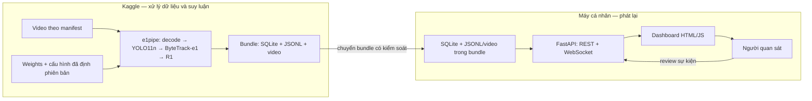
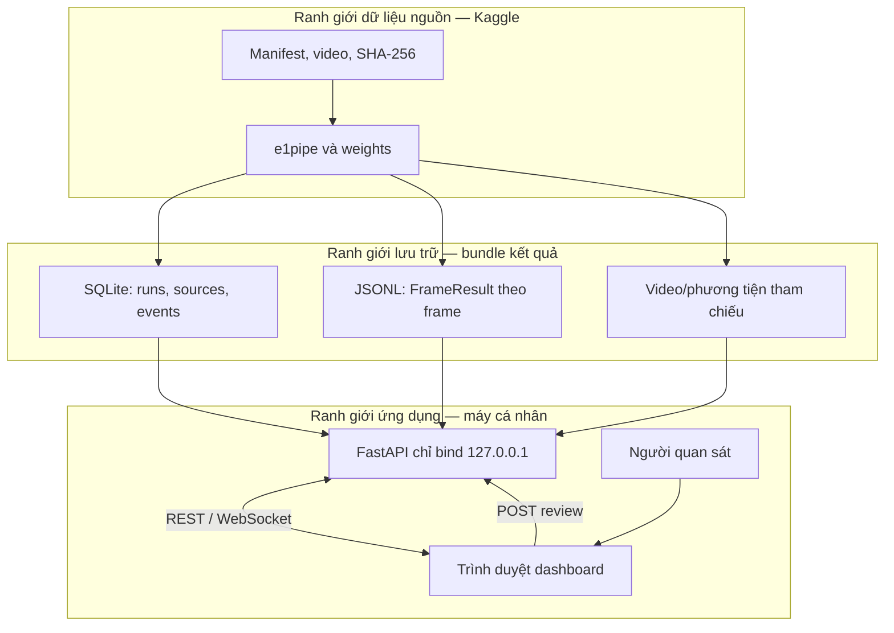
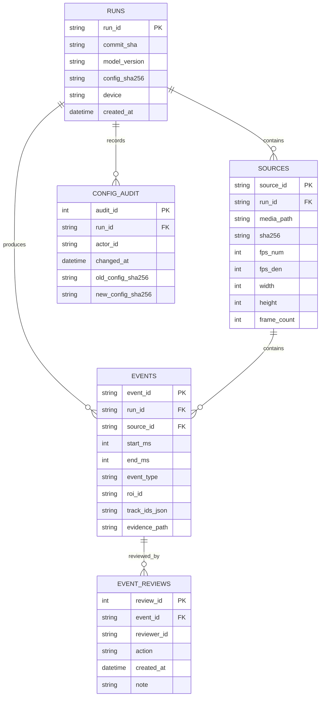
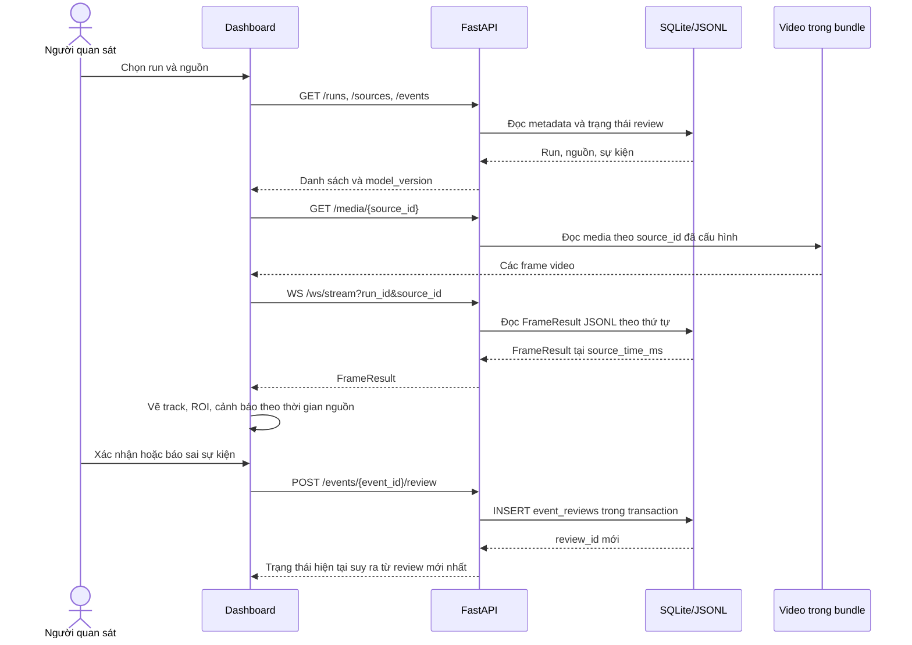

# Chương IV. Thiết kế hệ thống — bản nháp mục 4.1–4.2

**Trạng thái:** Bản nháp ngày 18/11/2026, theo kiến trúc phát lại W8 trong ADR-0015. ADR-0015 còn Proposed; lược đồ và cách xác định trạng thái review dưới đây cần được đồng bộ với ADR trước khi code được merge. Phần demo W8 là đầu-cuối về luồng dữ liệu, không phải suy luận thời gian thực.

## 4.1. Kiến trúc tổng thể

Hệ thống chia thành hai môi trường. Trên Kaggle, pipeline `e1pipe` đọc video và weights, chạy detector YOLO11n, ByteTrack-e1 và AlertEngine R1, rồi xuất bundle kết quả. Trên máy cá nhân, API FastAPI đọc bundle; dashboard HTML/JavaScript phát video và `FrameResult` theo thời gian nguồn, vẽ track/ROI/cảnh báo và gửi thao tác review. Máy cá nhân không chạy giải mã hoặc suy luận trên dữ liệu thật.

**Hình 4.1.** Các thành phần và luồng dữ liệu giữa job Kaggle và ứng dụng phát lại.

**Hình 4.2.** Sơ đồ triển khai và ranh giới tin cậy của MVP W8.

Bundle được tạo từ manifest và cấu hình đã lưu cùng run; `model_version` là SHA-256 của weights. Bundle chuyển sang máy cá nhân theo cách có kiểm soát, không đưa video hoặc frame nguồn lên Git hay nơi công khai. Đường dẫn media chỉ được phân giải từ danh sách nguồn trong bundle, không nhận URL hoặc đường dẫn tệp tùy ý từ client. API chỉ lắng nghe loopback; cấu hình này giới hạn truy cập mạng cho demo nhưng không thay thế xác thực người dùng. W8 chưa triển khai tài khoản hay phân quyền; nội dung review chưa được xem là danh tính đã xác minh. FBD-SV-2024, nếu được dùng theo ADR-0014, vẫn tuân thủ riêng điều kiện không phân phối video/frame/nhãn.

Ranh giới chức năng của demo là: video đã được xử lý trên Kaggle; API phát lại media và kết quả theo `source_time_ms`; người quan sát review sự kiện; thay đổi review được lưu thành bản ghi mới. Dấu thời gian nguồn không phải đồng hồ xử lý thời gian thực. Dashboard phải báo mất kết nối/kết quả quá hạn thay vì giữ hình cũ như thể luồng vẫn đang hoạt động.

## 4.2. Thiết kế cơ sở dữ liệu và API

### Lược đồ dữ liệu

Các bảng dưới đây là lược đồ đề xuất cho bundle W8. Khóa ngoại SQLite được bật; khi ghi một sự kiện hoặc review, các thao tác liên quan thực hiện trong transaction.

| Bảng | Trường chính | Vai trò và ràng buộc |
|---|---|---|
| `runs` | `run_id` PK, `commit_sha`, `model_version`, `config_sha256`, `device`, `created_at` | Một lần chạy pipeline. `model_version` lưu SHA-256 weights, không dùng tên model có thể thay đổi làm định danh. `config_sha256` định danh cấu hình detector/tracker/ROI/cảnh báo. |
| `sources` | `source_id` PK, `run_id` FK, `name`, `media_path`, `sha256`, `fps_num`, `fps_den`, `width`, `height`, `frame_count` | Một nguồn video trong run. `media_path` là đường dẫn tương đối trong bundle; `UNIQUE(run_id, source_id)` hỗ trợ kiểm tra khóa tổng hợp của `events`. |
| `events` | `event_id` PK, `run_id`, `source_id`, `start_ms`, `end_ms`, `start_frame`, `end_frame`, `event_type`, `roi_id`, `track_ids_json`, `evidence_path`, `created_at` | Bản ghi sự kiện do pipeline sinh, bất biến sau khi tạo. `(run_id, source_id)` tham chiếu nguồn thuộc cùng run. Không cập nhật trạng thái review trong bản ghi này. |
| `event_reviews` | `review_id` PK, `event_id` FK, `reviewer_id`, `action`, `created_at`, `note` | Nhật ký append-only. `action` thuộc `confirmed` hoặc `false_alarm`; không sửa/xóa review đã ghi. W8 chỉ ghi định danh cục bộ do ứng dụng cung cấp, chưa xác minh bằng tài khoản. |
| `config_audit` | `audit_id` PK, `run_id` FK, `actor_id`, `changed_at`, `old_config_sha256`, `new_config_sha256`, `change_summary` | Nhật ký append-only cho thay đổi cấu hình. Không lưu bí mật trong trường tóm tắt. Endpoint và thời điểm cho phép sửa cấu hình cần được chốt trong ADR trước khi triển khai. |

`FrameResult` lưu theo JSONL nén, không nhân bản trong SQLite. Mỗi record có `run_id`, `source_id`, `model_version`, `frame_index`, `source_time_ms`, `tracks[]` (ID, lớp, độ tin cậy, hộp `[x1,y1,x2,y2]`), `events[]` (ID và chuyển trạng thái), và `stage_latency_ms` (decode, detect, track, alert, persist). Các record cùng nguồn phải tăng đơn điệu theo `frame_index` và `source_time_ms`; thời gian nguồn lấy từ video, còn thời gian xử lý dùng để đo độ trễ riêng.

Sự kiện chỉ đọc từ `events`. Trạng thái review hiện tại được suy ra: `new` khi chưa có review, nếu có thì lấy `action` của review mới nhất theo `(created_at, review_id)`. Cách này giữ nhật ký bất biến và tránh trạng thái trong `events` lệch khỏi lịch sử review. Mỗi sự kiện phải tham chiếu một run và nguồn thuộc run đó; mỗi run ghi chính xác hash weights/cấu hình đã dùng. `config_audit` không thay thế cấu hình có phiên bản và chỉ ghi nhận thay đổi khi có thao tác được cho phép.

**Hình 4.3.** ERD đề xuất; `FrameResult` nằm trong JSONL, không phải bảng SQLite.

### Hợp đồng API

| Endpoint | Hợp đồng tóm tắt |
|---|---|
| `GET /health` | Trạng thái API và bundle đang mở. |
| `GET /runs` | Danh sách run cùng `model_version` và hash cấu hình. |
| `GET /sources?run_id=…` | Các nguồn thuộc run; trả `source_id`, metadata và thời lượng, không lộ đường dẫn máy tùy ý. |
| `GET /events?run_id=…&source_id=…` | Sự kiện theo nguồn, kèm trạng thái review suy ra từ nhật ký. |
| `GET /events/{event_id}` | Chi tiết sự kiện, run/source, thời gian nguồn, track và trạng thái review hiện tại. |
| `POST /events/{event_id}/review` | Body gồm `action` (`confirmed` hoặc `false_alarm`), `reviewer_id` cục bộ và `note` tùy chọn; chỉ INSERT một review mới, không UPDATE/DELETE. |
| `GET /media/{source_id}` | Phát video của nguồn đã cấu hình trong bundle; chỉ nhận ID nguồn, không nhận path/URL tùy ý. |
| `WS /ws/stream?run_id=…&source_id=…` | Phát từng `FrameResult` theo thời gian nguồn, đúng thứ tự; kết thúc khi hết JSONL/video hoặc client ngắt. Payload tuân theo cấu trúc `FrameResult` ở trên. |

OpenAPI do FastAPI sinh là hợp đồng REST; schema WebSocket được ghi cùng tài liệu API và kiểm thử bằng JSON mẫu. Các ngưỡng, lớp, ROI và nội dung bundle thuộc một run cố định; API phát lại không chạy suy luận hoặc thay đổi kết quả khi đổi cấu hình.

### Trình tự phát lại và xác nhận cảnh báo

**Hình 4.4.** Trình tự phát lại một run và ghi nhận review append-only.
